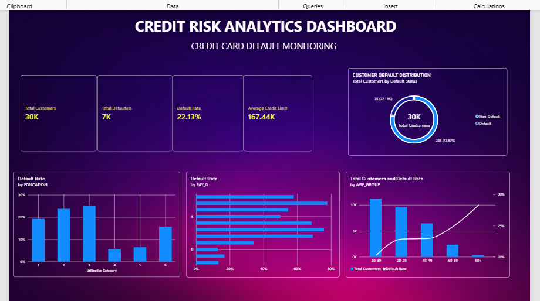
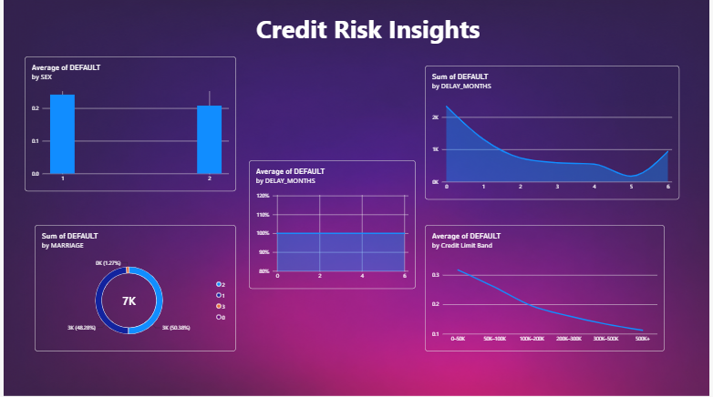

# Credit Card Default Risk Analysis

### An Interactive Power BI Dashboard for Credit Risk Analytics

An end-to-end data analytics project focused on analysing credit card customer behaviour, identifying default patterns, and understanding customer credit risk using Python, Jupyter Notebook, and Microsoft Power BI.

---

## 1. Project Overview

Credit card default is a significant challenge for financial institutions, affecting portfolio quality, profitability, and financial stability.

This project analyses customer demographics, credit limits, repayment behaviour, billing patterns, and payment history to identify patterns associated with credit card default.

The project combines data analysis and feature engineering using Python with interactive Power BI visualisations to transform raw customer data into meaningful credit risk insights.

## 2. Project Objectives

- Analyse the distribution of credit card defaults across customer segments.
- Examine the relationship between repayment delays and default rates.
- Investigate default patterns across different credit limit categories.
- Study customer demographics and their association with default behaviour.
- Analyse credit utilisation and repayment patterns.
- Develop an interactive dashboard for credit risk analysis and portfolio monitoring.

## 3. Technology Stack

| Technology | Application |
|---|---|
| Python | Data analysis and preprocessing |
| Jupyter Notebook | Exploratory data analysis |
| Pandas | Data manipulation |
| NumPy | Numerical computations |
| Matplotlib | Data visualisation |
| Microsoft Power BI | Interactive dashboard development |
| DAX | Measures and calculated columns |
| Excel / CSV | Dataset management |

## 4. Dataset Description

The project uses a credit card default dataset containing customer demographic information, credit limits, historical billing amounts, repayment status, and payment amounts.

### Important Features

| Feature | Description |
|---|---|
| LIMIT_BAL | Credit limit assigned to the customer |
| SEX | Customer gender |
| EDUCATION | Customer education category |
| MARRIAGE | Customer marital status |
| AGE | Customer age |
| PAY_0 to PAY_6 | Historical repayment status |
| BILL_AMT1 to BILL_AMT6 | Historical bill amounts |
| PAY_AMT1 to PAY_AMT6 | Historical payment amounts |
| DEFAULT | Credit card default indicator |

### Target Variable

- `1` – Default
- `0` – Non-Default

## 5. Data Preparation and Feature Engineering

Data preparation and feature engineering were performed to facilitate meaningful customer segmentation and credit risk analysis.

The project incorporates the following derived features:

- **Age Group:** Categorisation of customers by age.
- **Credit Utilisation:** Ratio of bill amount to assigned credit limit.
- **Delay Months:** Repayment delay information.
- **Behavioural Segment:** Customer segmentation based on repayment behaviour.
- **Credit Limit Band:** Grouping customers according to assigned credit limits.
- **Utilisation Category:** Classification of customers based on credit utilisation.

## 6. Power BI Dashboard

The Power BI report consists of two analytical pages designed to provide an overview of portfolio performance and customer-level risk patterns.

### Page 1: Credit Risk Analytics Dashboard

This page provides a high-level overview of the credit card portfolio through key performance indicators and visualisations.

**Key Performance Indicators**

- Total Customers
- Total Defaulters
- Overall Default Rate
- Average Credit Limit

**Visualisations**

- Default Rate by Age Group
- Default Rate by Current Repayment Status
- Default Rate by Credit Utilisation
- Customer Distribution by Credit Utilisation
- Default Rate by Education



### Page 2: Credit Risk Insights

This page focuses on customer segmentation and repayment-related default patterns.

**Visualisations**

- Default Rate by Gender
- Default Rate by Marriage Status
- Default Rate by Credit Limit
- Default Rate by Repayment Delay



## 7. DAX Measures

The dashboard uses DAX measures to calculate important portfolio indicators.

### Total Customers

```DAX
Total Customers = COUNTROWS(CustomerData)
```

### Total Defaulters

```DAX
Total Defaulters =
CALCULATE(
    COUNTROWS(CustomerData),
    CustomerData[DEFAULT] = 1
)
```

### Default Rate

```DAX
Default Rate =
DIVIDE(
    [Total Defaulters],
    [Total Customers],
    0
)
```

### Average Credit Limit

```DAX
Average Credit Limit =
AVERAGE(CustomerData[LIMIT_BAL])
```

For segment-level default rates, the average of the binary `DEFAULT` variable is used. Since the target variable is encoded as 0 and 1, its average represents the proportion of customers who defaulted within the selected segment.

## 8. Key Analytical Areas

The dashboard enables exploration of the following credit risk dimensions:

**Demographic Analysis**

Comparison of default rates across age, gender, education, and marital status.

**Repayment Behaviour**

Examination of repayment status and delay patterns to understand their association with default.

**Credit Exposure**

Analysis of customer credit limits and credit utilisation categories.

**Portfolio Monitoring**

Assessment of overall customer distribution and default rates through key performance indicators.

These analyses are exploratory and identify associations rather than establishing causal relationships.

## 9. Repository Structure

```text
Credit-Card-Default-Risk-Analysis/
│
├── Credit_Risk_Analytics_Dashboard.pbix
├── Credit_Risk_Analysis (1).ipynb
├── credit_risk_cleaned_data (1).csv
├── dashboard_overview.png
├── credit_risk_insights.png
└── README.md
```

## 10. Future Improvements

- Develop machine learning models for credit card default prediction.
- Compare classification algorithms using precision, recall, F1-score, and ROC-AUC.
- Implement explainable AI techniques such as SHAP.
- Develop customer-level credit risk scoring.
- Incorporate early warning indicators for potential defaults.
- Extend the analysis towards Expected Credit Loss modelling using appropriate Exposure at Default and Loss Given Default assumptions.

## 11. Author

**Sompartha Sinha**

BS in Data Science and Applications  
**Indian Institute of Technology Madras (IIT Madras)**

- **GitHub:** [sompartha](https://github.com/sompartha)
- **LinkedIn:** [Sompartha Sinha](https://www.linkedin.com/in/sompartha-sinha-46b055298/)

---

*This project was developed as a data analytics and credit risk exploration project using Python and Microsoft Power BI.*
